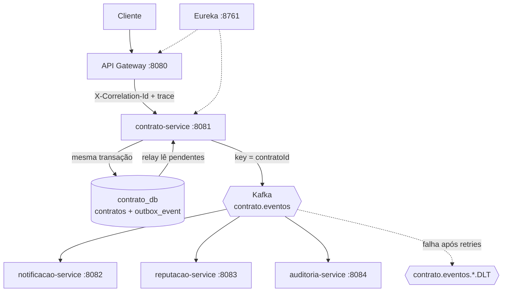

# Freela Marketplace

Marketplace de contratação de freelancers construído com arquitetura de microsserviços em Java e Spring. Clientes contratam freelancers para a execução de trabalhos, e o núcleo do sistema é o gerenciamento dos contratos firmados entre as partes.

Nesta versão, a comunicação entre os serviços é orientada a eventos: o `contrato-service` publica eventos do ciclo de vida do contrato no Apache Kafka e os serviços de notificação, reputação e auditoria reagem de forma assíncrona, sem chamadas HTTP entre eles. A solução inclui publicação transacional (Transactional Outbox), consumidores idempotentes, retry com Dead Letter Topic, logs centralizados (ELK) e rastreamento distribuído (Zipkin).

Especificação completa das mensagens: [docs/especificacao-mensagens.md](docs/especificacao-mensagens.md)

## Sumário

1. [Visão geral da arquitetura](#1-visão-geral-da-arquitetura)
2. [Domínio](#2-domínio)
3. [Serviços participantes](#3-serviços-participantes)
4. [API Gateway e Eureka](#4-api-gateway-e-eureka)
5. [Por que o fluxo é assíncrono](#5-por-que-o-fluxo-é-assíncrono)
6. [Tópicos Kafka e eventos](#6-tópicos-kafka-e-eventos)
7. [Formato das mensagens](#7-formato-das-mensagens)
8. [Publicação transacional (Outbox)](#8-publicação-transacional-outbox)
9. [Particionamento e ordenação](#9-estratégia-de-particionamento-e-ordenação)
10. [Idempotência](#10-estratégia-de-idempotência)
11. [Tratamento de falhas (retry e DLT)](#11-tratamento-de-falhas-retry-e-dlt)
12. [Logs: padronização e centralização](#12-logs-padronização-e-centralização)
13. [Correlação das operações](#13-correlação-das-operações)
14. [Rastreamento distribuído](#14-rastreamento-distribuído-zipkin)
15. [Infraestrutura e inicialização](#15-infraestrutura-e-inicialização)
16. [Exemplos de chamadas](#16-exemplos-de-chamadas-para-geração-de-eventos)
17. [Decisões de arquitetura](#17-decisões-de-arquitetura)
18. [Limitações conhecidas](#18-limitações-conhecidas)
19. [Evidências](#19-evidências)
20. [Tecnologias](#20-tecnologias)

---

## 1. Visão geral da arquitetura



Observabilidade: todos os serviços enviam traces ao Zipkin (`:9411`) e logs JSON ao Elasticsearch via Logstash, consultados no Kibana (`:5601`).

## 2. Domínio

O domínio principal está no `contrato-service`. Um contrato representa o vínculo entre um cliente e um freelancer para a execução de um trabalho e possui identificador, cliente, freelancer, título, valor, status e data de criação.

Estados e transições:

```text
ATIVO ──► ENTREGA_REGISTRADA ──► CONCLUIDO
  │               │
  └───────┬───────┘
          ▼
      CANCELADO   (não é permitido cancelar um contrato já concluído)
```

O serviço segue uma organização inspirada em Domain-Driven Design:

```text
contrato-service
└── src/main/java/br/com/freela/contrato
    ├── application            casos de uso (ContratoApplicationService)
    ├── domain
    │   ├── event              eventos de domínio (ContratoCriado, EntregaRegistrada, ContratoConcluido, ContratoCancelado)
    │   ├── model              Aggregate Contrato
    │   ├── repository         portas de persistência
    │   └── shared             DomainEvent, DomainEventPublisher
    └── infrastructure
        ├── persistence        JPA, adapter do outbox
        ├── messaging          relay do outbox, configuração do Kafka
        └── web                controller e filtro de correlação
```

O Aggregate `Contrato` concentra as regras das mudanças de estado e produz um evento de domínio a cada transição.

## 3. Serviços participantes

| Serviço | Porta | Responsabilidade | Banco | Recursos HTTP |
|---|---|---|---|---|
| eureka-server | 8761 | Registro e descoberta de serviços | — | — |
| api-gateway | 8080 | Entrada única, roteamento, geração do `X-Correlation-Id` | — | — |
| contrato-service | 8081 | Ciclo de vida do contrato; publica eventos via Outbox | `contrato_db` | `POST /api/contratos`, `GET /api/contratos`, `GET /api/contratos/{id}`, `POST /api/contratos/{id}/entrega`, `POST /api/contratos/{id}/conclusao` |
| notificacao-service | 8082 | Registra notificações para cliente e freelancer | `notificacao_db` | `GET /api/notificacoes` |
| reputacao-service | 8083 | Mantém contratos concluídos e valor total por freelancer | `reputacao_db` | `GET /api/reputacoes` |
| auditoria-service | 8084 | Registra todos os eventos processados pela plataforma | `auditoria_db` | `GET /api/auditoria` |

Cada serviço possui o seu próprio banco, e nenhum acessa o banco de outro. Entre os serviços não há chamadas HTTP: a integração acontece exclusivamente por eventos.

Cada registro de auditoria armazena `eventId`, `aggregateId` (id do contrato), tipo do evento, `correlationId`, payload original e horário de recebimento.

## 4. API Gateway e Eureka

O `api-gateway` é o ponto de entrada HTTP e localiza os serviços pelo Eureka.

| Caminho | Serviço |
|---|---|
| `/api/contratos/**` | `contrato-service` |
| `/api/notificacoes/**` | `notificacao-service` |
| `/api/reputacoes/**` | `reputacao-service` |
| `/api/auditoria/**` | `auditoria-service` |

O Gateway gera um UUID para o header `X-Correlation-Id` quando o cliente não o envia, e o encaminha ao serviço de destino. A interface do Eureka fica em `http://localhost:8761`, e os serviços se registram em `http://localhost:8761/eureka/`.

## 5. Por que o fluxo é assíncrono

- **Desacoplamento:** o `contrato-service` não conhece nem espera os consumidores. Ele só anuncia o fato.
- **Disponibilidade:** a criação de contratos é a operação que gera receita e não pode depender de serviços secundários. Se a notificação, a reputação ou o próprio Kafka estiverem fora do ar, o contrato continua sendo criado e o evento fica pendente no outbox até poder ser publicado.
- **Escalabilidade:** novos consumidores podem ser adicionados sem alterar o produtor.
- **Contrapartida:** a consistência passa a ser eventual. Por isso a solução tem Outbox, consumidores idempotentes e DLT.

## 6. Tópicos Kafka e eventos

| Tópico | Partições | Produtor | Consumidores (group id) |
|---|---|---|---|
| `contrato.eventos` | 3 | contrato-service | `notificacao-service`, `reputacao-service`, `auditoria-service` |
| `contrato.eventos.auditoria.DLT` | 3 | auditoria-service | — (diagnóstico) |
| `contrato.eventos.notificacao.DLT` | 3 | notificacao-service | — (diagnóstico) |
| `contrato.eventos.reputacao.DLT` | 3 | reputacao-service | — (diagnóstico) |

Eventos publicados em `contrato.eventos`:

| Evento | Quando ocorre | Serviços que agem |
|---|---|---|
| `ContratoCriado` | Contrato criado (status ATIVO) | notificacao, auditoria |
| `EntregaRegistrada` | Entrega registrada (ATIVO → ENTREGA_REGISTRADA) | notificacao, auditoria |
| `ContratoConcluido` | Contrato concluído (ENTREGA_REGISTRADA → CONCLUIDO) | notificacao, reputacao, auditoria |
| `ContratoCancelado` | Contrato cancelado | notificacao, auditoria |

Todos os consumidores assinam o tópico inteiro. Cada um ignora, sem erro, os tipos que não lhe interessam (a reputação, por exemplo, só processa `ContratoConcluido`).

## 7. Formato das mensagens

JSON plano, um objeto por mensagem, com os campos `eventId`, `eventType`, `occurredAt`, `correlationId`, `contratoId`, `clienteId`, `freelancerId`, `titulo` e `valor`. A chave da mensagem é o `contratoId`. Headers Kafka: `correlationId` e o contexto de trace (`traceparent`). Campos obrigatórios e um exemplo por evento em [docs/especificacao-mensagens.md](docs/especificacao-mensagens.md).

## 8. Publicação transacional (Outbox)

O `contrato-service` não publica no Kafka dentro da requisição. Na mesma transação que salva o contrato, ele grava o evento na tabela `outbox_event` do `contrato_db`. Um relay publica os pendentes no Kafka.

```text
@Transactional  (ContratoApplicationService)
  salva Contrato
  OutboxDomainEventPublisher.publicar(eventos)  →  insere em outbox_event
commit  ← contrato e evento juntos, ou nenhum dos dois

OutboxRelay  (@Scheduled, fixedDelay = 500 ms)
  lê até 50 eventos pendentes, ordenados por sequencia
  envia ao Kafka (key = contratoId) e aguarda a confirmação
  marca publicado_em
  em falha: registra o erro e interrompe o lote (preserva a ordem)
```

Tabela `outbox_event`:

| Coluna | Uso |
|---|---|
| `sequencia` | Número crescente; define a ordem de publicação |
| `event_id` (único) | Identificador do evento, o mesmo do evento de domínio |
| `aggregate_id` | `contratoId`; vira a chave da mensagem |
| `event_type` | Tipo do evento |
| `correlation_id` | Identificador de correlação da requisição |
| `trace_context` | Contexto do trace da requisição (JSON), restaurado pelo relay |
| `payload` | JSON da mensagem, já pronto para envio |
| `criado_em` / `publicado_em` | `publicado_em` nulo indica evento pendente |

Garantia de entrega: **at-least-once**. Se o relay publicar e a aplicação cair antes de marcar o evento como publicado, o evento é reenviado. Os consumidores tratam a duplicata (seção 10).

## 9. Estratégia de particionamento e ordenação

- Tópico único `contrato.eventos`, 3 partições.
- Chave da mensagem = `contratoId`. A mesma chave sempre resulta na mesma partição, então os eventos de um contrato são consumidos na ordem em que foram registrados.
- O relay publica por `sequencia` crescente, aguarda a confirmação do broker a cada envio e interrompe o lote em caso de falha.
- Contratos diferentes podem cair em partições diferentes e ser processados em paralelo.
- Concorrência dos consumidores (`spring.kafka.listener.concurrency`): auditoria = 3, notificação = 3, reputação = 1. A reputação usa 1 porque ela atualiza um contador por freelancer, e dois contratos do mesmo freelancer processados ao mesmo tempo, em partições diferentes, poderiam perder um incremento.

## 10. Estratégia de idempotência

Cada evento tem um `eventId` único, gerado uma vez na criação do evento de domínio e mantido até o consumidor.

| Serviço | Mecanismo |
|---|---|
| auditoria | `event_id` com restrição UNIQUE em `auditoria_eventos` |
| notificacao | Consulta por `eventId` antes de processar; restrição UNIQUE em `(event_id, destinatario_id)` |
| reputacao | Tabela `eventos_processados` com `event_id` UNIQUE; o marcador e o incremento do contador são gravados na mesma transação |

Duas camadas em cada consumidor: a consulta prévia trata a reentrega comum, e a restrição do banco é a garantia final contra processamento concorrente. O log distingue os dois casos com o campo `deteccao=consulta` ou `deteccao=constraint` (nível WARN para o segundo), o que permite procurar no Kibana se a concorrência chegou a ocorrer.

## 11. Tratamento de falhas (retry e DLT)

Configuração em `KafkaErrorConfig` (cada consumidor):

- 4 retentativas com backoff exponencial (1 s, 2 s, 4 s, 8 s).
- Esgotadas as tentativas, a mensagem é publicada na DLT do serviço (`contrato.eventos.<servico>.DLT`), na mesma partição, e o consumo segue para as próximas.
- Exceções não recuperáveis (`JsonProcessingException`, `IllegalArgumentException`) vão direto para a DLT, sem retentativa.
- Uma falha em um consumidor não afeta os outros dois, porque cada serviço tem o seu próprio grupo de consumo.
- Reprocessamento: copiar key e value da mensagem na DLT (Kafka UI) e republicá-la em `contrato.eventos`.

## 12. Logs: padronização e centralização

**Padronização.** Todos os serviços emitem logs em JSON (formato ECS do Spring Boot, `logging.structured.format`). Campos presentes quando aplicável: `service.name`, `correlationId`, `contratoId`, `eventId`, `traceId`, `spanId`, nível, logger e mensagem, além dos registros de início, conclusão, falha, recebimento e publicação (`contrato.outbox.registrado`, `contrato.outbox.publicado`, `*.evento.recebido`, `*.evento.duplicado`, `*.evento.dlt`). O `correlationId`, `contratoId` e `eventId` são colocados no MDC e saem como campos separados. Dados pessoais e o payload completo das mensagens não são registrados.

**Centralização (ELK).**

```text
serviços → arquivos logs/*.log (JSON) → Logstash → Elasticsearch (freela-logs-AAAA.MM.DD) → Kibana
```

No Kibana, Data View `freela-logs-*`, campo de tempo `@timestamp`. Buscas em KQL:

```text
correlationId : "<id>"
contratoId    : "<id>"
eventId       : "<id>"
```

Uma busca por `correlationId` mostra a mesma operação nos quatro serviços.

## 13. Correlação das operações

- O API Gateway gera o `X-Correlation-Id` quando o cliente não o envia (e preserva o valor quando enviado).
- No `contrato-service`, um filtro lê o header e o coloca no MDC; o valor vai para todos os logs da requisição.
- O `OutboxDomainEventPublisher` grava o valor na coluna `correlation_id` e no campo `correlationId` do JSON.
- O relay o envia também como header Kafka e o coloca no MDC durante a publicação.
- Cada consumidor lê o `correlationId` da mensagem e o coloca no MDC.

O `contrato-service` assume que toda requisição passa pelo Gateway, que é o responsável por gerar o identificador.

## 14. Rastreamento distribuído (Zipkin)

Micrometer Tracing com o exportador Zipkin (sucessor do Spring Cloud Sleuth nas versões atuais do Spring Boot).

Dependência em todos os serviços (incluindo o gateway):

```xml
<dependency>
    <groupId>org.springframework.boot</groupId>
    <artifactId>spring-boot-starter-zipkin</artifactId>
</dependency>
```

Configuração:

```yaml
management:
  tracing:
    sampling:
      probability: 1.0        # 100% das requisições
```

- `contrato-service`: `spring.kafka.template.observation-enabled: true`.
- Consumidores: `spring.kafka.listener.observation-enabled: true`.
- Gateway: `spring.reactor.context-propagation: auto`.
- O contexto de trace da requisição é gravado em `outbox_event.trace_context`. O relay o restaura, abre o span `outbox.publicar <Evento>` como filho da requisição e envia ao Kafka dentro dele, mantendo um único trace de ponta a ponta.
- O Spring não gera mais spans para cada execução do `@Scheduled` do relay (`management.observations.enable.tasks.scheduled.execution: false`), e o gateway descarta os spans internos de infraestrutura (Eureka e Actuator).

Estrutura do trace de uma criação de contrato:

```text
api-gateway: http post
  └─ contrato-service: http post /api/contratos
       └─ contrato-service: outbox.publicar ContratoCriado
            └─ contrato-service: contrato.eventos send
                 ├─ notificacao-service: contrato.eventos process
                 ├─ reputacao-service:   contrato.eventos process
                 └─ auditoria-service:   contrato.eventos process
```

## 15. Infraestrutura e inicialização

Pré-requisitos: Docker, Java 21 e Maven.

Os serviços de infraestrutura estão em `infra/docker-compose.yml`:

```bash
cd infra
docker compose up -d        # sobe PostgreSQL, Kafka, Kafka UI, Zipkin, Elasticsearch, Logstash e Kibana
docker compose ps           # verifica os containers
docker compose down         # encerra, mantendo os dados do PostgreSQL
docker compose down -v      # encerra e remove os dados persistidos
```

| Componente | Endereço |
|---|---|
| PostgreSQL | `localhost:5432` (usuário e senha `freela`) |
| Kafka (KRaft, sem ZooKeeper) | `localhost:9092` (aplicações na máquina) · `kafka:19092` (rede Docker) |
| Kafka UI | http://localhost:8090 |
| Zipkin | http://localhost:9411 |
| Elasticsearch | http://localhost:9200 |
| Kibana | http://localhost:5601 |

O PostgreSQL usa uma única instância com um banco por serviço (`contrato_db`, `notificacao_db`, `reputacao_db`, `auditoria_db`), criados por `infra/postgres/init-databases.sql`. Os serviços usam Hibernate com `ddl-auto: update` para criar e atualizar as tabelas locais.

Aplicações (um terminal por serviço, na raiz do repositório e nesta ordem):

```bash
mvn -pl eureka-server spring-boot:run
mvn -pl api-gateway spring-boot:run
mvn -pl contrato-service spring-boot:run
mvn -pl notificacao-service spring-boot:run
mvn -pl reputacao-service spring-boot:run
mvn -pl auditoria-service spring-boot:run
```

Portas: API Gateway `8080`, contrato `8081`, notificação `8082`, reputação `8083`, auditoria `8084`, Eureka `8761`, Kafka `9092`, Kafka UI `8090`, PostgreSQL `5432`, Zipkin `9411`, Elasticsearch `9200`, Kibana `5601`.

Os logs são gravados em `logging.file.name` de cada serviço (pasta `logs/`), que o Logstash monta como volume somente leitura. Ajuste o caminho do volume no `infra/docker-compose.yml` caso a pasta esteja em outro lugar.

Para o Kibana: **Stack Management → Data Views → Create data view**, nome e padrão `freela-logs-*`, campo de tempo `@timestamp`.

## 16. Exemplos de chamadas para geração de eventos

Todas as chamadas passam pelo Gateway. No PowerShell, use `curl.exe`.

Criar contrato (gera `ContratoCriado`):

```bash
curl -i -X POST http://localhost:8080/api/contratos \
  -H 'Content-Type: application/json' \
  -H 'X-Correlation-Id: demo-001' \
  -d '{"clienteId":"11111111-1111-1111-1111-111111111111","freelancerId":"11111111-1111-1111-1111-111111111113","titulo":"Construção de API de pagamentos","valor":3500.00}'
```

Registrar entrega (gera `EntregaRegistrada`):

```bash
curl -i -X POST http://localhost:8080/api/contratos/{contratoId}/entrega \
  -H 'X-Correlation-Id: demo-002'
```

Concluir contrato (gera `ContratoConcluido`):

```bash
curl -i -X POST http://localhost:8080/api/contratos/{contratoId}/conclusao \
  -H 'X-Correlation-Id: demo-003'
```

Consultas de verificação:

```bash
curl http://localhost:8080/api/contratos
curl http://localhost:8080/api/contratos/{contratoId}
curl http://localhost:8080/api/reputacoes
curl http://localhost:8080/api/auditoria
curl http://localhost:8080/api/notificacoes
```

O `ContratoCancelado` existe no domínio e na especificação, mas ainda não há endpoint HTTP que acione o cancelamento.

## 17. Decisões de arquitetura

| Decisão | Motivo |
|---|---|
| Transactional Outbox em vez de publicar direto no Kafka | Evita inconsistência entre banco e Kafka e mantém a criação de contratos disponível mesmo com o Kafka fora do ar |
| Relay por polling (`@Scheduled`, 500 ms) em vez de CDC | Mais simples de operar e suficiente para o escopo; o CDC (ex.: Debezium) é a alternativa para volumes maiores |
| Um único tópico para todo o ciclo de vida do contrato | A ordem só é garantida dentro de uma partição; tópicos por tipo de evento separariam os eventos de um mesmo contrato |
| Chave da mensagem = `contratoId` | Preserva a ordem por contrato e permite paralelismo entre contratos |
| At-least-once + consumidores idempotentes | O Outbox pode reenviar eventos; a idempotência por `eventId` evita efeitos duplicados |
| Payload autossuficiente (dados do contrato dentro do evento) | Os consumidores não precisam chamar o `contrato-service` de volta |
| Uma instância PostgreSQL com um banco por serviço | Isolamento lógico dos dados, suficiente para o ambiente; em produção, instâncias separadas dariam isolamento físico |
| Reputação com concorrência 1 | Evita perda de incremento entre contratos do mesmo freelancer em partições diferentes |
| Intervalo do relay de 500 ms | Equilíbrio entre latência de publicação e carga no banco |

## 18. Limitações conhecidas

- Testes automatizados (unidade, integração com broker, duplicidade e ordenação) não foram implementados; a duplicidade e a ordem foram verificadas manualmente (ver evidências).
- Não há endpoint HTTP para cancelamento de contrato; o evento `ContratoCancelado` está definido no domínio e na especificação.
- A regra atual de `cancelar()` impede apenas o cancelamento de contratos já concluídos.
- Reprocessamento da DLT é manual (republicação pelo Kafka UI).
- Todos os serviços usam o mesmo usuário de banco (`freela`); o isolamento entre bancos depende do código dos serviços.
- Sem autenticação: a consulta de notificações não filtra por usuário. Em produção, o destinatário viria do token autenticado.

## 19. Evidências

Os prints ficam em `docs/evidencias/`.

| # | Evidência | Arquivo                                                                                         |
|---|---|-------------------------------------------------------------------------------------------------|
| 1 | Requisição recebida pelo API Gateway | `01-gateway.png`                                                                                |
| 2 | Alteração persistida no contrato-service (tabelas `contratos` e `outbox_event`) | `02-contrato-banco.png, 02-outbox-banco.png`                                                    |
| 3 | Evento publicado no Kafka (Kafka UI, chave e partição) | `03-kafka-ui.png`                                                                               |
| 4 | Consumo do evento pelos três serviços | `04-consumo-notificacao.png, 04-consumo-auditoria.png, 04-consumo-reputacao.png`                |
| 5 | Persistência feita pelos consumidores | `05-persistencia-notificacao.png, 05-persistencia-auditoria.png, 05-persistencia-reputacao.png` |
| 6 | Logs da mesma operação consultados no Kibana | `06-kibana.png`                                                                                 |
| 7 | Trace completo no Zipkin | `07-zipkin.png`                                                                                 |

## 20. Tecnologias

```text
Java 21
Spring Boot 4.1
Spring Cloud (Gateway, Netflix Eureka)
Spring Data JPA
Spring for Apache Kafka
Micrometer Tracing + Zipkin
PostgreSQL 16
Apache Kafka 4 (KRaft)
Elasticsearch, Logstash e Kibana (ELK)
Docker Compose
Maven
```